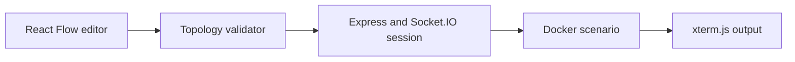
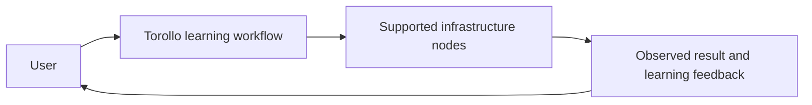

<h1 align="center">Torollo</h1>

<p align="center"><strong>A local-first visual simulator and educational playground for backend engineering and system design, inspired by Packet Tracer.</strong></p>

[](https://www.npmjs.com/package/torollo)
[](https://github.com/companionintelligence/Torollo)
[](LICENSE)
[](https://discord.com/invite/yQp9hwpzAa)

<p align="center"><a href="#quick-start">Get started</a> · <a href="https://docs.ci.computer/docs/reference/open-source-systems">Systems map</a> · <a href="README.md#architecture-overview">Documentation</a></p>

<p align="center">
  <a href="#quick-start"></a>
</p>

[](https://nodejs.org)


TOROLLO is an interactive, visual sandbox designed to help students and developers learn backend architecture, Docker, networking, databases, and system design by actually building and running systems on their local machines.


## Technology Stack
*   **Frontend:** React, TypeScript, Vite, React Flow, xterm.js
*   **Backend:** Node.js, Express, TypeScript, Socket.io
*   **Orchestration:** Docker, Dockerode (Interacts directly with your local Docker Daemon)

---

## Quick Start

Run the lab instantly from your terminal without needing to clone the repo or install anything permanently:

```bash
npx torollo start
```
*(Note: Ensure Docker Desktop is running before starting, as Torollo orchestrates real local containers)*

---

## Supported Infrastructure Nodes

You can drag and drop a wide range of infrastructure components onto the canvas. Everything is backed by **real Docker containers** running locally on your machine.

*   **Computing**
    *   **Ubuntu Server:** A basic Linux container. Includes a fully functional, native web-terminal integrated directly into your browser via WebSockets.
    *   **Auto Scaling Group (ASG):** Define a template and scale replicas up or down instantly.
*   **Databases / Caches**
    *   **PostgreSQL:** Relational database node. Features a built-in interactive Explorer to view schemas, tables, and execute SQL queries directly from the UI.
    *   **MongoDB (NoSQL):** Document database node. Features an interactive Explorer to view collections and run JSON queries without needing external GUI clients.
    *   **Redis (Cache Store):** In-memory data store. Includes a built-in Explorer to view keys and run native Redis CLI commands interactively.
*   **Networking & Security**
    *   **VPC & Subnets:** Isolated network boundaries backed by custom Docker bridge networks.
    *   **Security Groups:** Drag-and-drop visual firewall rules (Inbound/Outbound). Rules are converted and enforced using actual `iptables` injected securely into the containers.
    *   **Load Balancer (Nginx):** Automatically generates upstream `nginx.conf` configurations based on the nodes you wire to it.
    *   **NAT Gateway:** Provides outbound internet access for private subnets using true Linux `ip_forward=1` and `MASQUERADE` routing.

---

## Coming Very Soon

*   **Terraform Generation:** Automatic Infrastructure-as-Code (IaC) generation for your visual architectures, supporting every major cloud provider (AWS, Azure, GCP).
*   **Message Brokers:** RabbitMQ, Kafka
*   **Application Services:** API Service, Microservices Host, Serverless Functions
*   **Observability:** Live Metrics, Logs, & Monitoring Components

---


## How it fits together

The browser builds and validates a topology graph; the backend owns the live session and starts the selected Docker scenario.



## Core Features & Architecture

| Feature | What it provides |
|---|---|
| **Compose a topology** | Build an infrastructure graph in React Flow and validate links and roles before a run. |
| **Run scenarios** | A separate backend starts container scenarios and streams state to the browser. |
| **Learn interactively** | Use xterm.js to work in the sandbox and see how topology choices behave. |


### Interactive Learning by Doing
Instead of reading passive, theory-heavy documentation, you learn by *doing*:
- **Create Systems:** Drag and drop real components to build architectures.
- **Run & Connect:** Wire services together and see how they interact.
- **Simulate Traffic:** Use the built-in Network Simulator to send pings and watch mock traffic flow through the system.
- **Web Terminals:** Instantly open a root shell into any Ubuntu or Database container straight from the browser.

### Architecture Overview
*   **Backend:** Node.js, Express, TypeScript, and Dockerode. The backend acts as the supervisor—it manipulates the local Docker daemon, compiles your visual network topology into real `iptables` rules, and manages persistent state in `~/.torollo/projects.json`. Because those rules are applied *inside* the containers, every node image must ship with `iptables` and `iproute2` installed — see [Required tooling inside every node image](docs/adding-a-node.md#required-tooling-inside-every-node-image).
*   **Frontend:** React, TypeScript, Vite, and React Flow. Renders the interactive visual grid, node inspector modals, database explorers, and `xterm.js` terminals.

---

## Core Philosophy

Everything runs **locally** on your machine. 
- **No Cloud integrations** (No AWS credentials needed).
- **No remote infrastructure** is created, billed, or managed. 
- All nodes in the workspace correspond exactly to live Docker containers on your local system.

*Note: This project is strictly educational. It is not an AWS clone or a production infrastructure management tool—it is a sandboxed simulator designed to make system design tangible, visual, and fun.*

<!-- companion-hub-readme-deep-review -->

## Project status and operating model

The supported infrastructure nodes and currently available core features are listed above. Items under [Coming Very Soon](#coming-very-soon) are planned work and should not be treated as shipped behavior.



Use the Quick Start and technology stack sections to prepare the development environment before connecting infrastructure. Keep node credentials in local secrets/configuration and avoid sharing them in screenshots or public issue reports.

